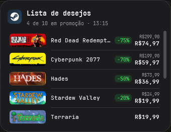
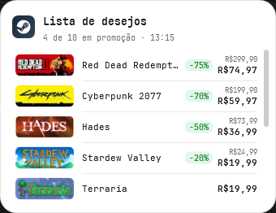
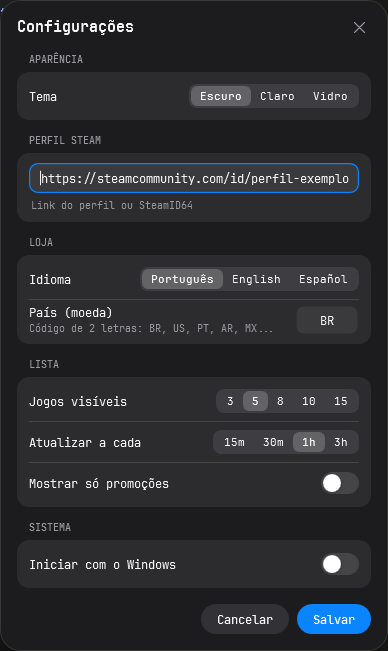

# 🎮 Steam Wishlist Widget

**Sua lista de desejos da Steam na área de trabalho do Windows, com as promoções sempre no topo.**

&nbsp;&nbsp;

[**⬇️ Baixar a versão mais recente**](../../releases/latest)

---

## ✨ Recursos

| | |
|---|---|
| 🏷️ **Promoções primeiro** | Jogos com desconto no topo (maior desconto primeiro), depois os mais baratos |
| 📜 **Lista completa** | Todos os jogos da lista de desejos, com barra de rolagem discreta |
| 🎨 **3 temas** | Escuro, Claro e Vidro (desfoque do fundo) |
| 🔽 **Modo ícone** | Minimiza para um ícone da Steam com o número de jogos em promoção |
| 📌 **Fixar** | Mantém o widget sempre visível sobre as outras janelas |
| 🔄 **Atualização automática** | A cada 15 min, 30 min, 1 h ou 3 h |
| 🚀 **Inicia com o Windows** | Opcional |
| 🔒 **Sem login** | Não pede senha nem conta; só o link do seu perfil |

---

## 📥 Instalação

1. Baixe o arquivo `SteamWishlistWidget-v<versão>-win-x64.exe` na página de [**Releases**](../../releases/latest)
2. Coloque o arquivo numa pasta fixa, por exemplo `C:\Apps\SteamWishlistWidget`
3. Abra com dois cliques

Não precisa instalar mais nada.

> **O Windows mostrou "O Windows protegeu o computador"?**
> Isso acontece com programas que não têm assinatura digital paga. Clique em **Mais informações → Executar assim mesmo**.

---

## 🚀 Primeiro uso

1. Deixe sua lista de desejos **pública** na Steam:
   **Perfil → Editar perfil → Configurações de privacidade → Detalhes do jogo → Público**
2. Abra o widget e cole o link do seu perfil:
   - `https://steamcommunity.com/id/seunome`
   - ou `https://steamcommunity.com/profiles/76561190000000001`

   (os links acima são só exemplos; use o do seu perfil)
3. Clique em **Conectar**

### Como usar

- **Arraste** o widget por qualquer parte para mudar de lugar
- **Passe o mouse** sobre o widget para ver os botões: configurações, atualizar, fixar, minimizar e fechar
- **Clique num jogo** para abrir a página dele na Steam
- **Clique direito** para o menu com as mesmas ações
- **Minimizado**, clique no ícone da Steam para abrir a lista de novo

---

## ⚙️ Configurações

Abra pelo ícone de engrenagem ou pelo clique direito → **Configurações...**

| Opção | Valores |
|---|---|
| **Tema** | Escuro, Claro, Vidro |
| **Perfil Steam** | Link do perfil ou SteamID64 |
| **Idioma** | Português, English, Español |
| **País (moeda)** | Código de 2 letras: `BR`, `US`, `PT`... |
| **Jogos visíveis** | 3, 5, 8, 10 ou 15 antes da rolagem |
| **Atualizar a cada** | 15 min, 30 min, 1 h, 3 h |
| **Só promoções** | Esconde os jogos sem desconto |
| **Iniciar com o Windows** | Liga ou desliga |

O tema muda na hora enquanto você escolhe; **Cancelar** volta ao anterior.

 

---

## 🔒 Privacidade

- O widget **não pede login nem senha**. Ele só lê informações públicas do seu perfil na Steam.
- Seu perfil fica salvo **criptografado** no seu computador e só pode ser lido pela sua conta do Windows.
- Nada é enviado para outros servidores além da própria Steam.

---

## ❓ Problemas comuns

<b>"Lista de desejos vazia ou privada"</b>

A Steam só mostra a lista de desejos se os **detalhes do jogo** do perfil estiverem públicos. Vá em **Perfil → Editar perfil → Configurações de privacidade → Detalhes do jogo** e escolha **Público**. Depois clique em atualizar no widget.

<b>"Perfil não encontrado"</b>

Confira o link. Ele deve ser do tipo `steamcommunity.com/id/seunome` ou `steamcommunity.com/profiles/76561190000000001` (exemplo). Você encontra o seu abrindo seu perfil na Steam e copiando o endereço.

<b>Os preços estão em outra moeda</b>

Abra as **Configurações** e ajuste o **País (moeda)**, por exemplo `BR` para reais.

<b>"Sem conexão com a Steam"</b>

Verifique sua internet. Se a Steam estiver fora do ar, o widget tenta de novo na próxima atualização automática, ou clique em atualizar.

<b>O widget sumiu da tela</b>

Se o monitor onde ele estava foi desconectado, o widget volta sozinho para a tela principal ao abrir de novo. Se ele estiver minimizado, procure o ícone redondo da Steam.

---

## 🗑️ Desinstalar

1. Abra as **Configurações** e desligue **Iniciar com o Windows**
2. Feche o widget (clique direito → **Fechar**)
3. Apague o arquivo `.exe` do widget
4. Opcional: apague a pasta `%AppData%\SteamWishlistWidget` para remover suas configurações

---

## 🤝 Quer contribuir?

Veja o [guia para contribuidores](docs/CONTRIBUTING.md): o que aceitamos, como o projeto funciona, como rodar pelo código e como enviar melhorias.

Encontrou um problema ou tem uma ideia? Abra uma [issue](../../issues/new/choose).

Encontrou uma **falha de segurança**? Não abra issue pública: veja a [política de segurança](SECURITY.md).

---

## 📄 Licença

Distribuído sob a [licença MIT](LICENSE): você pode usar, copiar, modificar e distribuir livremente, mantendo o aviso de copyright.

---

## 🙏 Créditos

- Fonte [JetBrains Mono](https://github.com/JetBrains/JetBrainsMono), licença SIL Open Font License 1.1
- Dados e imagens da [Steam](https://store.steampowered.com). Este projeto não tem vínculo com a Valve.
