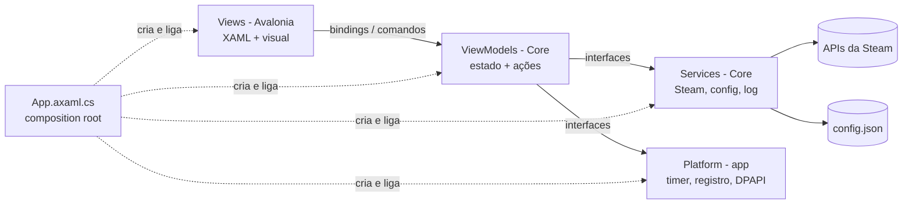
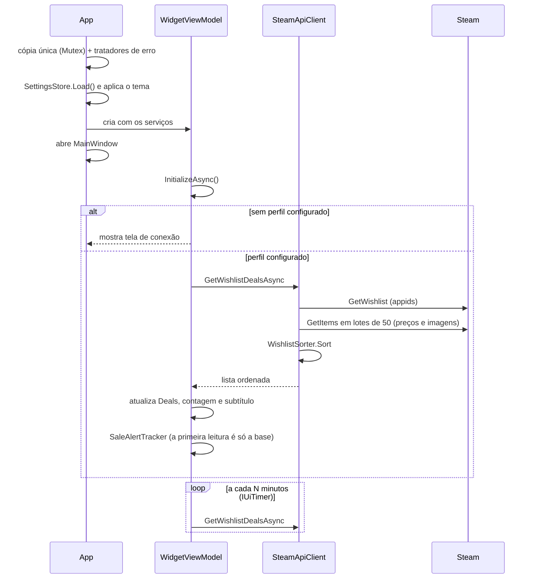

# 🛠️ Guia para contribuidores

Este documento explica como o **Steam Wishlist Widget** funciona por dentro e como preparar o ambiente para contribuir. Se você só quer usar o widget, veja o [README](../README.md).

## Sumário

- [O que aceitamos](#o-que-aceitamos)
- [Requisitos](#requisitos)
- [Primeiros passos](#primeiros-passos)
- [Estrutura do projeto](#estrutura-do-projeto)
- [Arquitetura (MVVM)](#arquitetura-mvvm)
- [Fluxo de funcionamento](#fluxo-de-funcionamento)
- [APIs da Steam](#apis-da-steam)
- [Temas e estilos](#temas-e-estilos)
- [Configurações do usuário](#configurações-do-usuário)
- [Segurança](#segurança)
- [Testes](#testes)
- [Build, CI e releases](#build-ci-e-releases)
- [Receitas comuns](#receitas-comuns)
- [Padrões de código](#padrões-de-código)
- [Como enviar uma contribuição](#como-enviar-uma-contribuição)
- [Depuração](#depuração)

---

## O que aceitamos

A ideia do widget é ser **leve, simples e seguro**: mostrar a lista de desejos e as promoções sem pedir nada além do link do perfil. As contribuições devem manter isso.

### ✅ Bem-vindas

| Tipo | Observação |
|---|---|
| 🐞 Correções de bug | Com um teste que reproduza o problema |
| 🌎 Novos idiomas e países da loja | Veja a [receita](#adicionar-um-novo-idioma-da-loja) |
| 🗣️ Tradução da interface | Hoje os textos estão fixos em português; abra uma issue antes para combinarmos como separar os textos |
| 🎨 Novos temas | Com todas as chaves de cor; veja a [receita](#adicionar-um-novo-tema) |
| ♿ Acessibilidade | Navegação por teclado, contraste, leitor de tela |
| ✨ Funcionalidades pequenas | Alinhadas com a proposta do widget, por exemplo: filtro por preço máximo, mostrar até quando vai a promoção |
| 🧪 Testes e 📖 documentação | Sempre bem-vindos |

### 💬 Só com uma issue discutida antes

- Mudanças grandes de visual ou de arquitetura
- Novas dependências NuGet
- Novas telas ou mudanças no fluxo de uso

Ideias já mapeadas, com dificuldade e pistas de implementação, estão em [Implementações futuras](ROADMAP.md).

### Como propor

1. Para bugs e ideias, abra uma **issue** usando os modelos (🐞 problema ou 💡 sugestão)
2. Para algo da lista "só com issue discutida antes", espere um retorno na issue antes de começar
3. Tarefas boas para começar ficam marcadas com a etiqueta **`good first issue`**

Ao contribuir, você concorda que seu código será distribuído sob a [licença MIT](../LICENSE) do projeto.

---

## Requisitos

- Windows 10 ou 11 para rodar o widget completo (no Linux já compila e rodam os testes e o modo demonstração; o suporte completo está no [roadmap](ROADMAP.md#-suporte-a-linux)). macOS não é suportado
- [.NET 10 SDK](https://dotnet.microsoft.com/download/dotnet/10.0) (versão de suporte longo, até novembro de 2028)
- Um editor com suporte a C# e Avalonia: JetBrains Rider, Visual Studio 2022 ou VS Code (com as extensões C# Dev Kit e [Avalonia](https://marketplace.visualstudio.com/items?itemName=AvaloniaTeam.vscode-avalonia))
- Uma conta Steam com a lista de desejos **pública**, para testar com dados reais

## Primeiros passos

```bash
git clone https://github.com/Azincourt-tech/Widget-Steam-Wishlist.git
cd Widget-Steam-Wishlist
dotnet build SteamWishlistWidget.sln
dotnet test SteamWishlistWidget.sln
dotnet run --project src/SteamWishlistWidget
```

O widget só abre uma cópia por vez. Se ele já estiver aberto (inclusive uma versão instalada pelo `.exe`), feche-o antes de rodar pelo código, senão a nova execução encerra sozinha.

### Modo demonstração

Para testar a interface sem conta Steam, ou para tirar prints sem expor dados pessoais:

```bash
dotnet run --project src/SteamWishlistWidget -- --demo
dotnet run --project src/SteamWishlistWidget -- --demo --theme=Light
```

| Opção | Efeito |
|---|---|
| `--demo` | Usa uma lista fixa de jogos de exemplo, com preços e SteamID fictícios (`Services/Demo/`). Não lê nem grava o `config.json`, não mexe no registro e não chama a API da lista de desejos. Pode rodar junto com o widget normal. |
| `--theme=Dark\|Light\|Glass` | Tema inicial do modo demonstração |

> 📸 As imagens do README (`docs/*.png`) devem ser geradas no modo demonstração. Nunca use prints com o seu perfil ou a sua lista de desejos reais.

## Estrutura do projeto

```
SteamWishlistWidget/
├── SteamWishlistWidget.sln
├── Directory.Build.props            Configurações comuns de build (versão, avisos como erro)
├── .editorconfig                    Padrão de código
├── .github/                         CI (ci.yml), release (release.yml), Dependabot, modelos de issue e de PR
├── docs/                            Esta documentação e as imagens do README
├── src/
│   ├── SteamWishlistWidget.Core/        Núcleo: roda em qualquer sistema, sem interface
│   │   ├── StartupOptions.cs            Opções de linha de comando (--demo, --theme)
│   │   ├── Constants/                   Endereços da Steam e caminhos do app
│   │   ├── Models/                      AppSettings (com validação), GameDeal, ThemeNames
│   │   ├── ViewModels/
│   │   │   ├── WidgetViewModel.cs       Estado e ações do widget (lista, fixar, minimizar...)
│   │   │   └── SettingsViewModel.cs     Estado e validação da tela de configurações
│   │   └── Services/
│   │       ├── Abstractions/            Interfaces (Steam, config, timer, criptografia, telas, notificações...)
│   │       ├── Demo/                    Serviços com dados fictícios para o modo demonstração
│   │       ├── Security/                WindowsDataProtector (DPAPI)
│   │       ├── SteamApiClient.cs        Chamadas às APIs da Steam e leitura das respostas
│   │       ├── SteamIdParser.cs         Entende link do perfil, /id/nome ou SteamID64
│   │       ├── WishlistSorter.cs        Promoções primeiro, depois mais baratos
│   │       ├── SettingsStore.cs         Lê e grava o config.json (atômico, validado)
│   │       ├── StoreLauncher.cs         Abre a página do jogo na loja
│   │       ├── SaleAlertTracker.cs      Descobre os jogos que entraram agora em promoção
│   │       ├── NoNotificationService.cs Notificação que não faz nada (modo demonstração, outros sistemas)
│   │       └── ErrorLog.cs              Log de erros local
│   └── SteamWishlistWidget/             Interface em Avalonia
│       ├── Program.cs                   Ponto de entrada: cópia única e erros globais
│       ├── App.axaml(.cs)               Monta os serviços (composition root) e aplica o tema
│       ├── Assets/                      icon.ico (ícone do .exe e das janelas) e Fonts/ (JetBrains Mono embutida)
│       ├── Controls/RemoteImage.cs      Carrega as capas dos jogos da internet
│       ├── Converters/                  Conversores de binding (ex.: RadioButton ↔ valor)
│       ├── Platform/                    Escolha da implementação por sistema e timer da interface
│       │   └── Windows/                 Registro (iniciar com o Windows), notificações e cantos da janela (DWM)
│       ├── Styles/                      Controls.axaml (estilos) e Icons.axaml (ícones vetoriais)
│       ├── Themes/                      Dark.axaml, Light.axaml, Glass.axaml, ThemeManager e ThemeService
│       └── Views/                       MainWindow, SettingsWindow e DialogService
└── tests/SteamWishlistWidget.Tests/     Testes do núcleo (rodam em Windows e Linux)
    ├── Fakes/                           Versões falsas dos serviços (sem internet, disco ou registro)
    ├── ViewModels/                      Testes dos ViewModels
    └── *.cs                             Testes dos serviços
```

**Por que dois projetos?** O `Core` não referencia nenhuma biblioteca de interface nem API exclusiva de um sistema (a DPAPI fica isolada em `WindowsDataProtector`, marcada como só-Windows). Assim os ViewModels e serviços podem ser testados em qualquer sistema e reaproveitados quando o widget ganhar suporte ao Linux.

## Arquitetura (MVVM)

A interface usa [**Avalonia**](https://avaloniaui.net) (versão 12), um framework de interface .NET multiplataforma com XAML, e o padrão **MVVM** com o [CommunityToolkit.Mvvm](https://learn.microsoft.com/dotnet/communitytoolkit/mvvm/).



| Camada | Onde | Responsabilidade | Não deve |
|---|---|---|---|
| **Views** | `SteamWishlistWidget/Views` | XAML, bindings e comportamento puramente visual: arrastar a janela, efeito vidro, sombra por tema, manter a borda no lugar ao minimizar | Conter regra de negócio, chamar a Steam ou gravar configurações |
| **ViewModels** | `Core/ViewModels` | Estado da tela (`[ObservableProperty]`) e ações (`[RelayCommand]`) | Referenciar janelas, Avalonia ou classes concretas de serviço |
| **Services** | `Core/Services` | Acesso à Steam, configurações, log | Conhecer ViewModels, telas ou APIs de um sistema específico |
| **Platform** | `SteamWishlistWidget/Platform` | O que muda por sistema: timer da interface, iniciar com o sistema, criptografia, notificações, cantos da janela | Ter regra de negócio |
| **App.axaml.cs** | `SteamWishlistWidget` | Único lugar que cria os serviços e entrega a quem precisa | Ter lógica além da montagem |

Os ViewModels recebem **interfaces** (`Core/Services/Abstractions`). Isso permite trocar a implementação real por uma falsa nos testes e por outra implementação em cada sistema operacional.

Quando um ViewModel precisa de algo da tela, ele expõe uma propriedade ou um evento e a View reage:

- `CloseRequested`: a View fecha a janela
- `IsCollapsed`: a View troca entre painel e ícone e mantém a borda no lugar
- `Theme`: a View ajusta a margem da sombra e o efeito vidro
- `IDialogService.ShowSettingsAsync`: abre a tela de configurações sem o ViewModel conhecer a janela
- `IUiTimer`: dispara a atualização automática na thread da interface

## Fluxo de funcionamento



## APIs da Steam

Todas são públicas, sem API key. Os endereços ficam em `Constants/SteamEndpoints.cs`.

| Endpoint | Uso | Leitura da resposta |
|---|---|---|
| `IWishlistService/GetWishlist/v1` | AppIDs da lista de desejos pelo SteamID | `SteamApiClient.ParseWishlistAppIds` |
| `IStoreBrowseService/GetItems/v1` | Nome, preço, desconto e imagens, no país e idioma escolhidos | `SteamApiClient.ParseStoreItems` |
| `steamcommunity.com/id/<nome>/?xml=1` | Converte link `/id/nome` em SteamID64 | `SteamApiClient.ParseSteamIdFromProfileXml` |

Observações:

- A lista de desejos só é retornada se os **detalhes do jogo** do perfil forem públicos. Caso contrário a resposta vem vazia.
- Jogos sem `best_purchase_option` (não lançados, gratuitos ou indisponíveis na região) são ignorados.
- As imagens são montadas a partir de `asset_url_format` e só são aceitas se apontarem para os servidores de imagem da Steam.
- A leitura das respostas fica em métodos **estáticos**, separada do acesso à internet, para ser testada com JSON/XML de exemplo.

## Temas e estilos

- **Cores**: cada tema é um `ResourceDictionary` em `Themes/` com as mesmas chaves (`TextMain`, `PanelBackground`, `Accent`...). `Glass.axaml` reaproveita o `Dark.axaml` e só troca o fundo do painel.
- **Troca de tema**: `ThemeManager.Apply` adiciona o dicionário do tema em `Application.Resources.MergedDictionaries` (e remove o anterior) e ajusta a variante clara/escura dos controles padrão do Fluent. Por isso as cores devem ser usadas sempre com `{DynamicResource ...}`.
- **Estilos**: `Styles/Controls.axaml` tem os estilos (classes `icon`, `pill`, `round`, `segmentTrack`) e os `ControlTheme` do controle segmentado (`SegmentTheme`) e do interruptor (`SwitchTheme`). Os ícones são caminhos vetoriais em `Styles/Icons.axaml`, para não depender de fontes de ícones do Windows.
- **Capas dos jogos**: o Avalonia não carrega imagens da internet sozinho; `Controls/RemoteImage.cs` faz isso (`ctl:RemoteImage.Url="{Binding ImageUrl}"`), com cache em memória e só de servidores da Steam.
- **Efeito vidro**: `TransparencyLevelHint = AcrylicBlur` do Avalonia. No Windows, o tema Vidro liga a moldura "só borda" do sistema (`WindowDecorations.BorderOnly`), que arredonda os cantos com o raio nativo do Windows 11 (8 px) e corta o desfoque nessa curva; `Platform/Windows/WindowsCorners.cs` desliga o contorno claro do sistema.

> ⚠️ O desfoque do Windows cobre o retângulo inteiro da janela e ignora cantos desenhados pela interface. O único recorte que ele respeita é o arredondamento nativo da moldura. Por isso, no tema Vidro, o painel usa `WindowsCorners.SystemCornerRadius` (8 px) em vez dos 20 px dos outros temas. Para conferir os cantos, coloque o widget sobre um fundo listrado: um fundo liso desfocado continua igual e esconde o problema.

> ⚠️ O Avalonia compila os `ResourceInclude` do XAML, e eles deixam de ser identificáveis depois. Por isso o tema não é declarado no `App.axaml`: o `ThemeManager` guarda a referência do dicionário que ele mesmo adicionou.

## Ícone e notificações

- **Ícone:** `Assets/icon.ico` (16 a 256 px, PNG dentro do `.ico`) vira o ícone do `.exe` (`ApplicationIcon`) e das janelas (`Icon`). `docs/icon.png` é a versão de 256 px. O desenho (coração com etiqueta de desconto) é próprio; não use o logo da Steam, para não sugerir que o widget é oficial da Valve.
- **Quando avisar:** depois de cada leitura, o `WidgetViewModel` passa a lista ao `SaleAlertTracker`, que devolve só os jogos que **entraram agora** em promoção. A primeira leitura é só a base (abrir o widget não avisa nada). Trocar de perfil, país ou idioma zera a base. Se o jogo sair da promoção e voltar, avisa de novo. Com o interruptor desligado, a base continua sendo atualizada, para não chegar uma enxurrada de avisos ao religar.
- **Como avisar:** `INotificationService`. No Windows, `Platform/Windows/WindowsNotificationService.cs` usa o pacote `Microsoft.Toolkit.Uwp.Notifications`; no modo demonstração e fora do Windows, `NoNotificationService`.
- O pacote exige o alvo do Windows 10: no Windows o app compila como `net10.0-windows10.0.19041.0` (a pasta de saída é `bin/<Config>/net10.0-windows10.0.19041.0/`), fora dele como `net10.0`, e o código fica dentro de `#if WINDOWS`. O csproj fixa o `System.Drawing.Common` 10.0.0, porque o pacote puxa a 4.7.0, que tem falha de segurança conhecida.
- Na primeira notificação, o pacote registra o widget em `HKCU\Software\Classes\AppUserModelId\<caminho do exe>`, com o nome do `AssemblyTitle` e o ícone do `.exe`.
- Para conferir sem esperar uma promoção de verdade: num projeto de console temporário que referencie o app, chame `new WindowsNotificationService().NotifySale(...)` com um jogo fictício, leia `ToastNotificationManagerCompat.History.GetHistory()` e termine com `ToastNotificationManagerCompat.Uninstall()` para apagar o registro do console.

## Configurações do usuário

- Ficam em `%AppData%\SteamWishlistWidget\config.json` (`AppConstants.SettingsFile`).
- O modelo é `Core/Models/AppSettings.cs`. `Normalize()` corrige qualquer valor inválido, e deve ser chamado sempre que o valor vier de fora (arquivo ou tela).
- `Services/SettingsStore.cs` grava o SteamID criptografado no campo `SteamIdProtected`. Configurações antigas com `SteamId` em texto puro são migradas na leitura.
- A gravação é atômica: escreve num `.tmp` e substitui o arquivo no final.

## Segurança

| Proteção | Onde |
|---|---|
| SteamID criptografado com DPAPI (conta do usuário + entropia do app) | `Core/Services/Security/WindowsDataProtector.cs` (via `ISecretProtector`) |
| Validação de todos os campos lidos do disco ou da tela | `Models/AppSettings.Normalize` |
| XML do perfil lido sem DTD nem entidades externas (proteção contra XXE) | `SteamApiClient.ParseSteamIdFromProfileXml` |
| HTTPS, tempo limite de 20 s e resposta de no máximo 8 MB | `SteamApiClient.CreateHttpClient` |
| Imagens só dos servidores da Steam | `SteamApiClient.BuildImageUrl`, `Controls/RemoteImage.cs`, `SteamEndpoints.TrustedImageHosts` |
| Página da loja montada a partir do AppID numérico, nunca de texto externo | `Services/StoreLauncher.cs` |
| Erros vão para log local, sem SteamID | `Services/ErrorLog.cs` |
| Erros não tratados são registrados em vez de fechar o app | `Program.Main` e `App.OnFrameworkInitializationCompleted` |

Ao contribuir:

- Nunca registre o SteamID ou outros dados do perfil no log.
- Nunca coloque SteamIDs, links de perfil ou listas de desejos reais em testes, exemplos ou prints. Use os valores fictícios (`76561190000000001`, `perfil-exemplo`) e o modo demonstração.
- Toda URL nova deve ir para `SteamEndpoints` e usar HTTPS.
- Todo valor novo de configuração deve ser validado em `AppSettings.Normalize`.

## Testes

```bash
dotnet test SteamWishlistWidget.sln
```

- Framework: **xUnit**.
- `Fakes/Fakes.cs` tem versões falsas de todos os serviços. Use-as para testar ViewModels sem internet, disco ou registro.
- `TestSetup.cs` redireciona o `ErrorLog` para uma pasta temporária, para os testes não escreverem no log real.
- Os testes de `SettingsStore` usam um arquivo temporário por teste.

O que já está coberto:

- Leitura de links e SteamID (`SteamIdParserTests`)
- Leitura das respostas da Steam, incluindo respostas inesperadas e XML malicioso (`SteamApiClientParsingTests`)
- Ordenação da lista (`WishlistSorterTests`)
- Quais jogos entraram em promoção entre duas leituras (`SaleAlertTrackerTests`)
- Criptografia, migração e validação das configurações (`SettingsStoreTests`)
- ViewModels: carregar a lista, erro de rede, conectar perfil, fixar, minimizar, abrir a loja, avisar promoções novas, salvar e cancelar configurações

Toda mudança de comportamento deve vir com teste.

## Build, CI e releases

**Executável local** (um `.exe` único que já inclui o .NET):

```bash
dotnet publish src/SteamWishlistWidget -c Release -r win-x64 --self-contained -p:PublishSingleFile=true -p:IncludeNativeLibrariesForSelfExtract=true -p:EnableCompressionInSingleFile=true -o publish
```

O `.exe` fica com cerca de 60 MB, porque leva o .NET junto (e a ponte para as APIs do Windows 10 usadas nas notificações) e por isso não exige nada instalado no PC do usuário. Sem trimming: Avalonia e System.Text.Json usam reflexão.

**Branches**
- O trabalho vai na `develop` (e nos pull requests para ela).
- A `main` só recebe o que for lançado: cada envio para a `main` gera uma release.

**GitHub Actions**

| Workflow | Quando roda | O que faz |
|---|---|---|
| `.github/workflows/ci.yml` | Push na `develop` e pull requests para `main`/`develop` | Compila e roda os testes em **Windows e Ubuntu** |
| `.github/workflows/release.yml` | Push na `main` (ou à mão, pela aba Actions) | Testa, gera o `.exe` único e publica a release `v<Version>` com o arquivo `SteamWishlistWidget-v<Version>-win-x64.exe` |

Os dois usam o token do workflow com o mínimo de permissão (`contents: read` no CI; `contents: write` só na release). Nenhum secret é necessário.

**Publicar uma versão**
1. Suba a `<Version>` em `Directory.Build.props` (ex.: `1.0.0` → `1.1.0`)
2. Faça o merge da `develop` na `main`

O workflow lê a versão, **para se a release `v<Version>` já existir** (é preciso subir a versão) e cria a release com o `.exe` e as notas geradas a partir dos commits.

**Dependabot** (`.github/dependabot.yml`): toda segunda-feira abre PRs para a `develop` com versões novas dos pacotes NuGet (os do Avalonia juntos num PR) e das actions do GitHub.

**Falhas de segurança** são reportadas em particular, pela aba Security do repositório (veja [SECURITY.md](../SECURITY.md)).

## Receitas comuns

### Adicionar uma nova opção de configuração

1. Adicione a propriedade em `Core/Models/AppSettings.cs` e valide em `Normalize()`
2. Adicione a propriedade em `Core/ViewModels/SettingsViewModel.cs`: carregue no construtor e copie em `SaveAsync`/`CopyTo`
3. Adicione o controle em `Views/SettingsWindow.axaml` com binding
4. Use a opção no `WidgetViewModel` ou no serviço que precisar
5. Adicione testes em `SettingsStoreTests` e `SettingsViewModelTests`

### Adicionar uma nova cor ao tema

1. Adicione a mesma chave em `Themes/Dark.axaml` e `Themes/Light.axaml`
2. Use com `{DynamicResource NomeDaCor}`

### Adicionar um novo tema

1. Crie `Themes/NomeDoTema.axaml` com todas as chaves de cor
2. Adicione o nome em `Core/Models/ThemeNames.cs` (incluindo em `Normalize`)
3. Adicione a opção no segmentado de tema em `Views/SettingsWindow.axaml`

### Adicionar um novo idioma da loja

1. Adicione o código da Steam (ex.: `french`) em `AppSettings.Languages`
2. Adicione a opção em `Views/SettingsWindow.axaml`

## Padrões de código

- Avisos de compilação são tratados como **erro** (`Directory.Build.props`). O build precisa terminar com 0 avisos.
- Siga o `.editorconfig`: namespaces por arquivo, `using` fora do namespace, campos privados com `_camelCase`.
- Comentários e textos da interface em **português**.
- Uma classe ou interface por arquivo, com o mesmo nome do arquivo.
- Novas dependências NuGet só quando realmente necessárias.

## Como enviar uma contribuição

1. Confira se a ideia está em [o que aceitamos](#o-que-aceitamos) e, se for o caso, abra uma issue antes
2. Faça um fork e crie uma branch a partir de `develop` (ex.: `feature/filtro-por-preco`)
3. Faça a mudança, com testes
4. Garanta que tudo passa:
   ```bash
   dotnet build SteamWishlistWidget.sln
   dotnet test SteamWishlistWidget.sln
   ```
5. Abra o widget e confira a mudança na tela, nos três temas se mexeu em visual
6. Abra um pull request **para a `develop`**. O modelo de PR já traz um checklist; preencha o que mudou, por quê e, se for visual, prints do modo demonstração.

## Depuração

| O quê | Onde |
|---|---|
| Configurações | `%AppData%\SteamWishlistWidget\config.json` |
| Log de erros | `%LocalAppData%\SteamWishlistWidget\logs\error.log` |
| Começar do zero | Feche o widget e apague a pasta `%AppData%\SteamWishlistWidget` |
| Desligar "Iniciar com o Windows" à mão | Valor `SteamWishlistWidget` em `HKCU\Software\Microsoft\Windows\CurrentVersion\Run` |
| Registro das notificações | `HKCU\Software\Classes\AppUserModelId\<caminho do exe>` (criado na primeira notificação) |

Dicas:

- O `config.json` pode ser editado com o widget fechado. Valores inválidos voltam ao padrão.
- O `SteamIdProtected` só pode ser lido pela mesma conta do Windows que o gravou. Para trocar o perfil, use a tela de configurações ou apague o campo.
- Para testar a resposta da Steam manualmente:
  ```
  https://api.steampowered.com/IWishlistService/GetWishlist/v1/?steamid=<SteamID64>
  ```
